


  

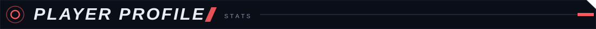
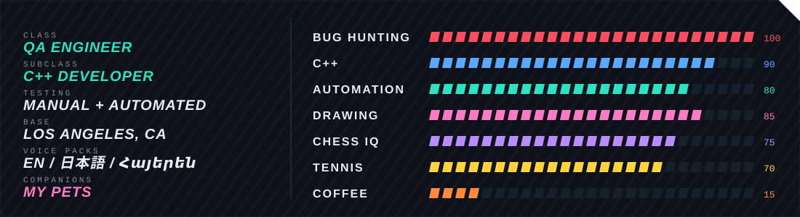

  

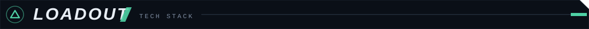
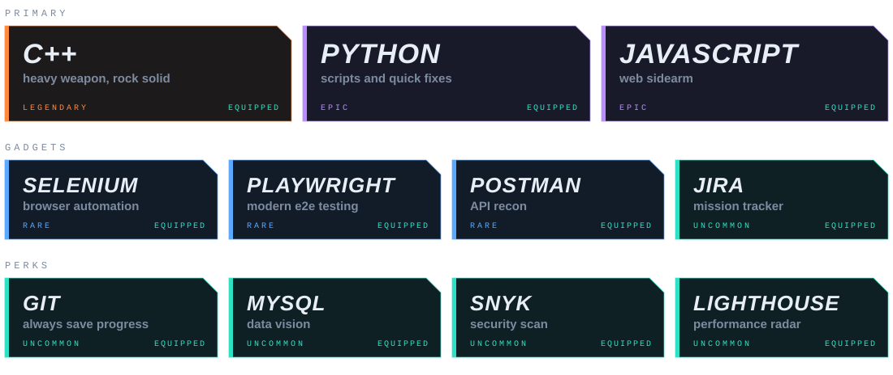

  

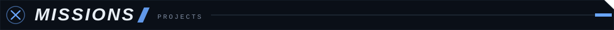

<a href="https://github.com/SerineGit/cpp-snake-game">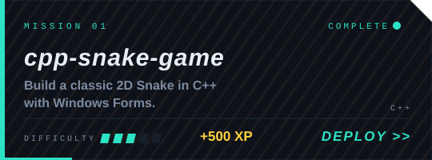</a>
<a href="https://github.com/SerineGit/Apple-and-X-AI-testing-project">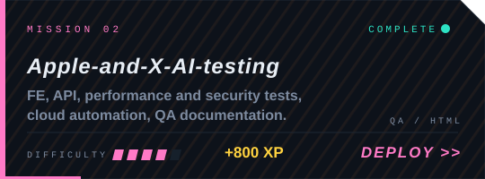</a>
<a href="https://github.com/SerineGit/Blue-Origin-and-X-AI-testing-project">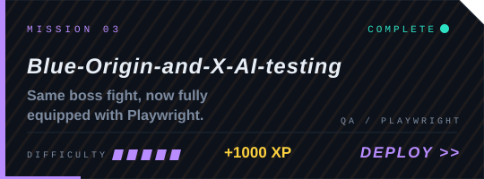</a>
<a href="https://github.com/SerineGit/Demo-Menu">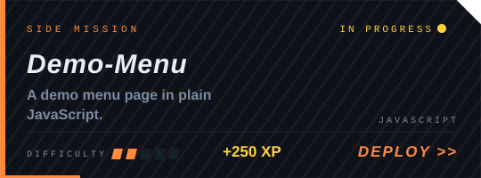</a>

  

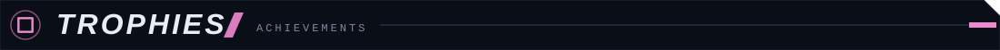
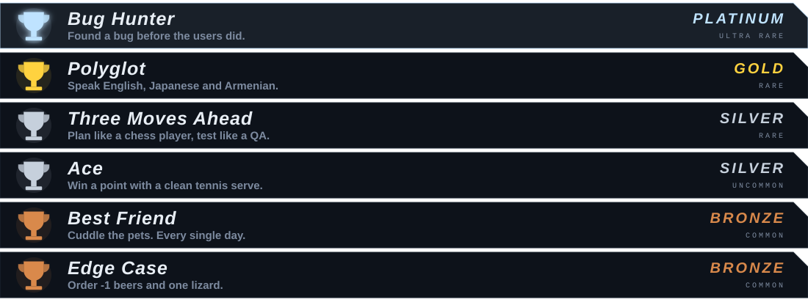

  

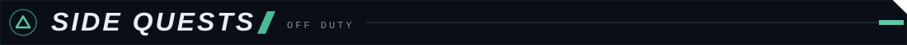
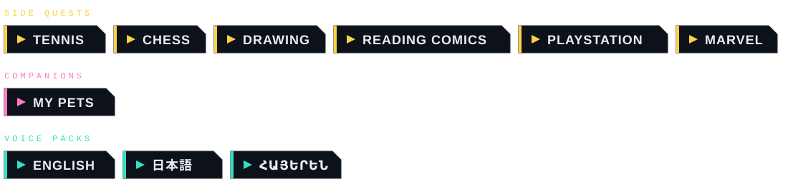

  

  

bonus level

 

 

