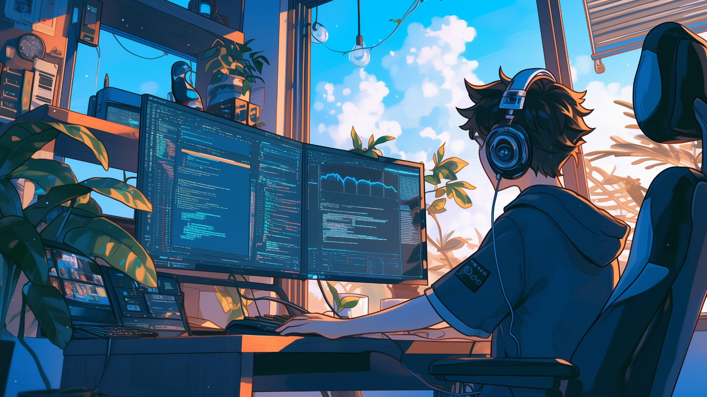

<h1 align="center">
🅷🅴🅻🅻🅾, 🆆🅾🆁🅻🅳! 👋  </h1>
 

<h3>🧪 QA by Day | 💻 C++ by Heart | ✅ Manual + ⚙️ Automated  🧠 Code. 🔧 Break. 🛠️ Fix. 🔁 Repeat.</h3>
  
 
  

  
    

 
<h2 align="center"> <pre>⚙️🆃🅾🅾🅻🆂 🅰🅽🅳 🅻🅰🅽🅶🆄🅰🅶🅴🆂</pre></h2>
  

        

  
More tools

                                  

      

   <h2 align="center"> <pre>🅰🅱🅾🆄🆃 🅼🅴 </pre></h2>
  

<h4> 🅻🅾🆅🅴 My pets, playing PS, Marvel.  🅷🅾🅱🅱🅸🅴🆂 Tennis, chess, drawing, reading comics.  🆂🅿🅴🅰🅺 English, Japanese and Armenian.   
 🅵🅸🅽🅳 🅼🅴 🅾🅽 </h4>  
   
 

 
  <h2 align="center"> <pre> 🅹🆄🆂🆃 🅵🅾🆁 🅵🆄🅽 🎉</pre></h2>
 

  

