

  

  


  


  

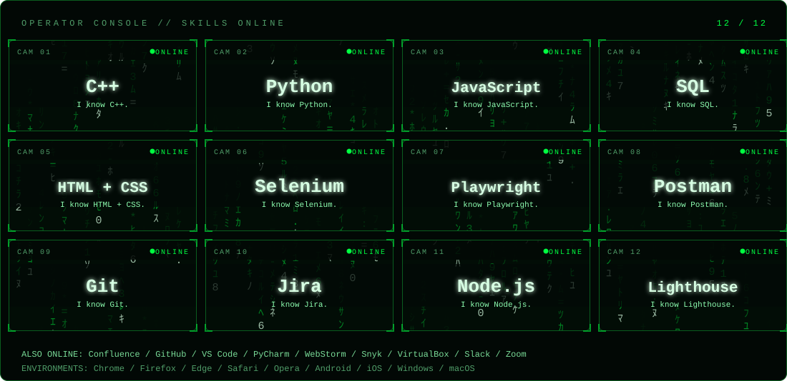

  


  


  


  

<a href="https://github.com/SerineGit/cpp-snake-game"></a>
<a href="https://github.com/SerineGit/Apple-and-X-AI-testing-project"></a>
<a href="https://github.com/SerineGit/Blue-Origin-and-X-AI-testing-project"></a>
<a href="https://github.com/SerineGit/Demo-Menu"></a>

  

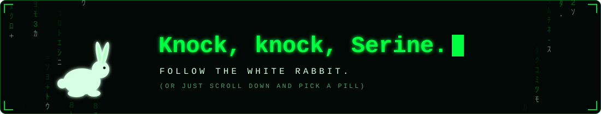

  

<a href="https://www.linkedin.com/in/serinezargaryan/">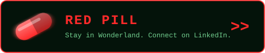</a>
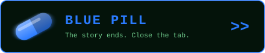

  

follow the white rabbit

 

 

